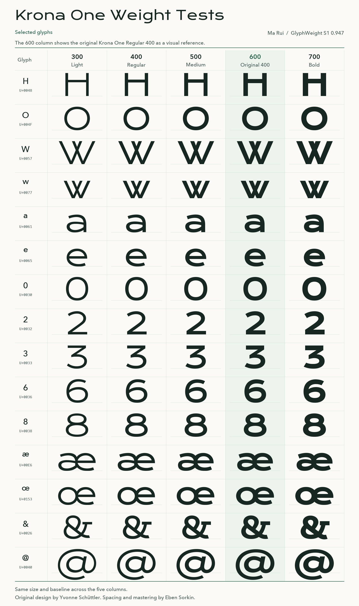

# Kronb

A wide, low-contrast sans-serif in five static weights. Kronb is an independent, unofficial extension of [Krona One](https://fonts.google.com/specimen/Krona+One).

## Preview

https://github.com/user-attachments/assets/6e9a11e7-689f-450a-9c2e-078567243760

[Film file (MP4, 11.5 seconds)](media/kronb-five-weights.mp4) · [Browse all eight character sheets](specimens/README.md)

### Selected glyphs

Read each row from Light 300 to Bold 700. The shaded 600 column shows the original Krona One drawing.

<a href="specimens/selected-glyphs.png"></a>

## Weights

| Weight | Style |
| --- | --- |
| 300 | Light |
| 400 | Regular |
| 500 | Medium |
| 600 | SemiBold |
| 700 | Bold |

Krona One was released in one Regular style. Kronb uses that drawing for **SemiBold 600**. Its glyph outlines, spacing, and rendering tables come from the original font. Its installation name and weight metadata are set to fit the Kronb family. Light, Regular, Medium, and Bold are new designs based on the original.

## Install

- **Desktop:** Open the [TTF folder](ttf), install all five files, and choose **Kronb** in your app’s font menu. Some older apps display Light, Medium, and SemiBold as separate families.
- **Web:** Use the files in the [WOFF2 folder](woff2). Declare one `@font-face` per file with its weight from the table. For example:

```css
@font-face {
  font-family: Kronb;
  src: url("woff2/Kronb-Regular.woff2") format("woff2");
  font-style: normal;
  font-weight: 400;
  font-display: swap;
}
```

The ZIP includes both formats. On GitHub, look for the ZIP under **Releases**. You can also use **Code → Download ZIP** to download the repository files.

## Credits and license

**Krona One:** Designed by Yvonne Schüttler, with spacing and mastering by Eben Sorkin. Original copyright © 2011, Sorkin Type Co. [Upstream source and license](https://github.com/google/fonts/tree/main/ofl/kronaone).

**Kronb:** New weight design by Ma Rui. This is an independent project.

Kronb is licensed under the [SIL Open Font License 1.1](OFL.txt).
