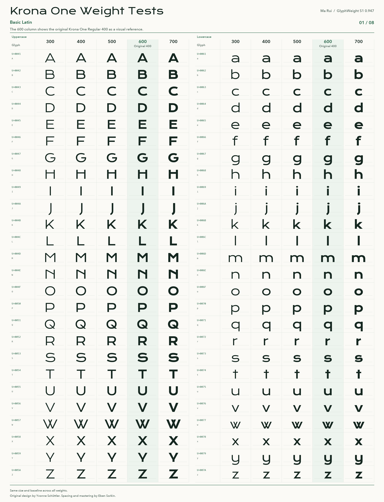
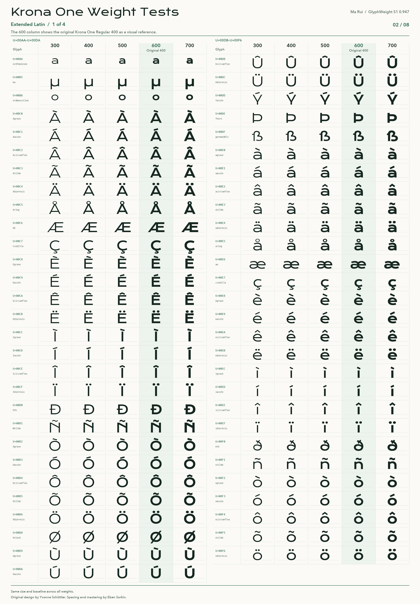
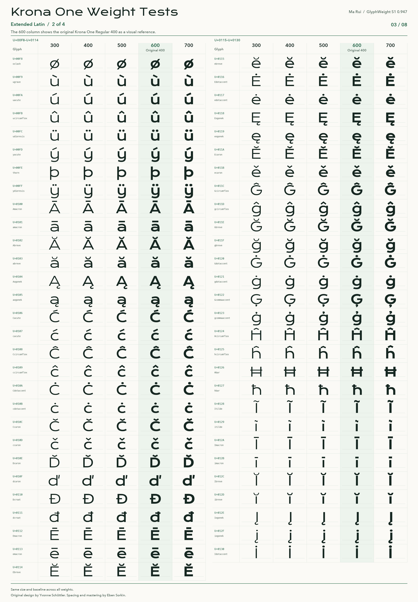
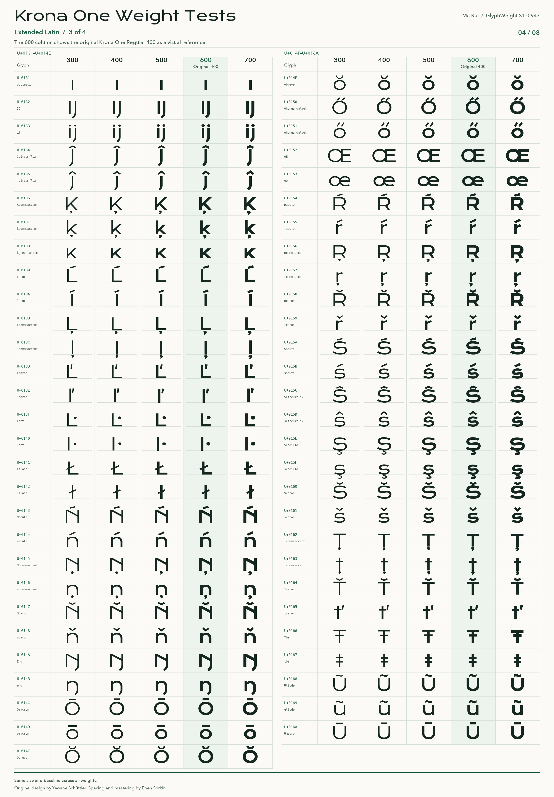
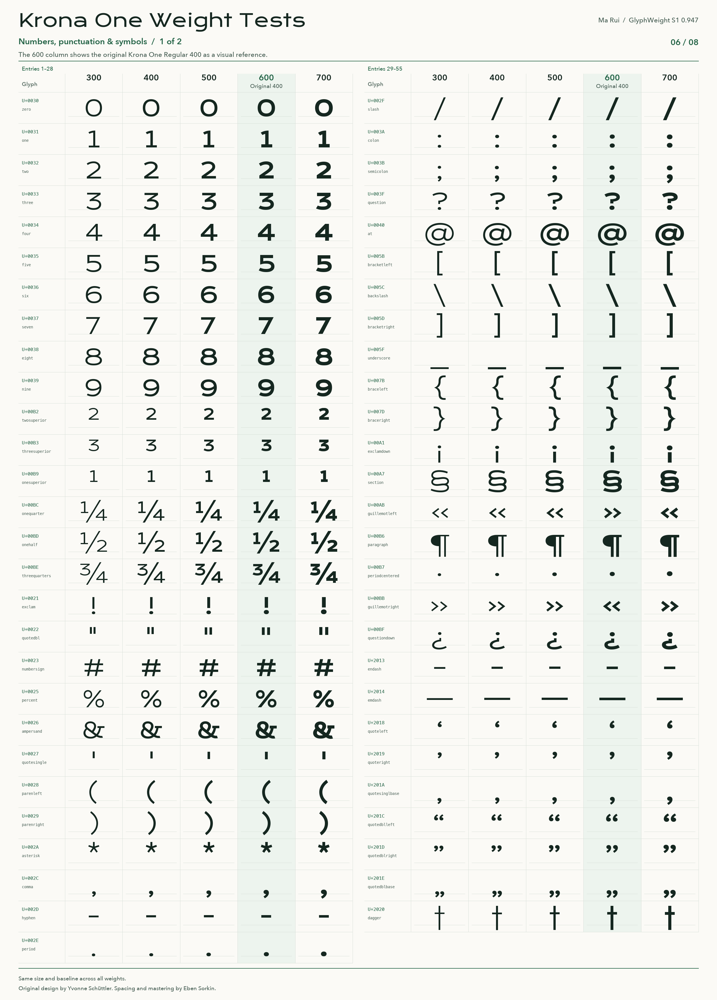

# Character sheets

Compare the same glyph across five weights, from Light 300 on the left to Bold 700 on the right. The shaded 600 column shows the original Krona One Regular drawing. The sheets cover 411 Unicode code points, plus 15 unencoded glyph entries.

The v0.947 proofs carry the project’s working name, *GlyphWeight S1*. The released family is **Kronb**.

[15 selected glyphs](selected-glyphs.png) · [Back to the film and font files](../README.md)

## Basic Latin

## Extended Latin (1 of 4)

## Extended Latin (2 of 4)

## Extended Latin (3 of 4)

## Extended Latin (4 of 4)

## Numbers and symbols (1 of 2)

## Numbers and symbols (2 of 2)

## Unencoded glyphs and blank entries

