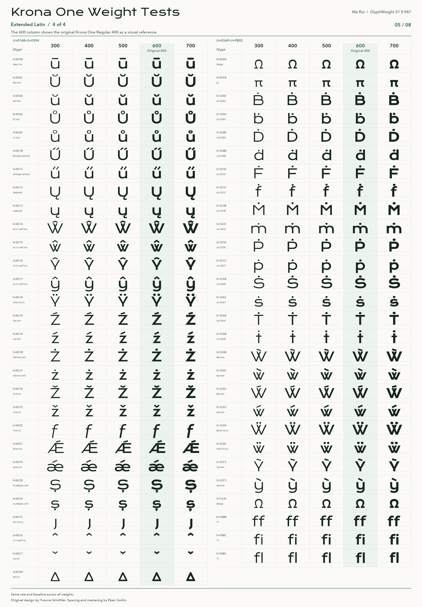
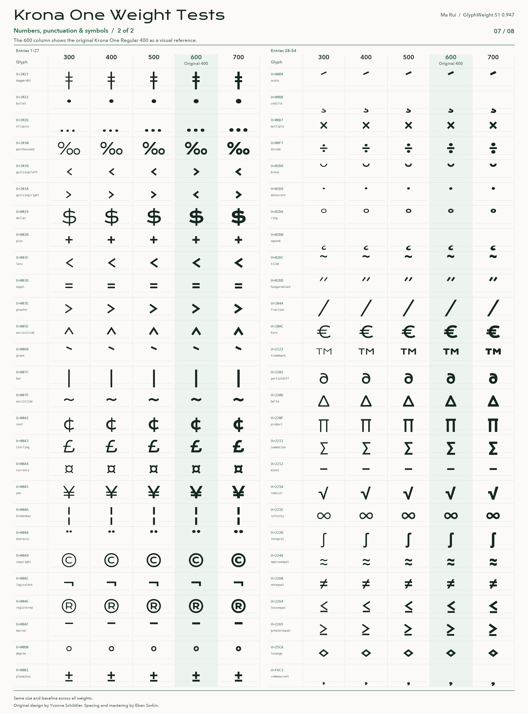
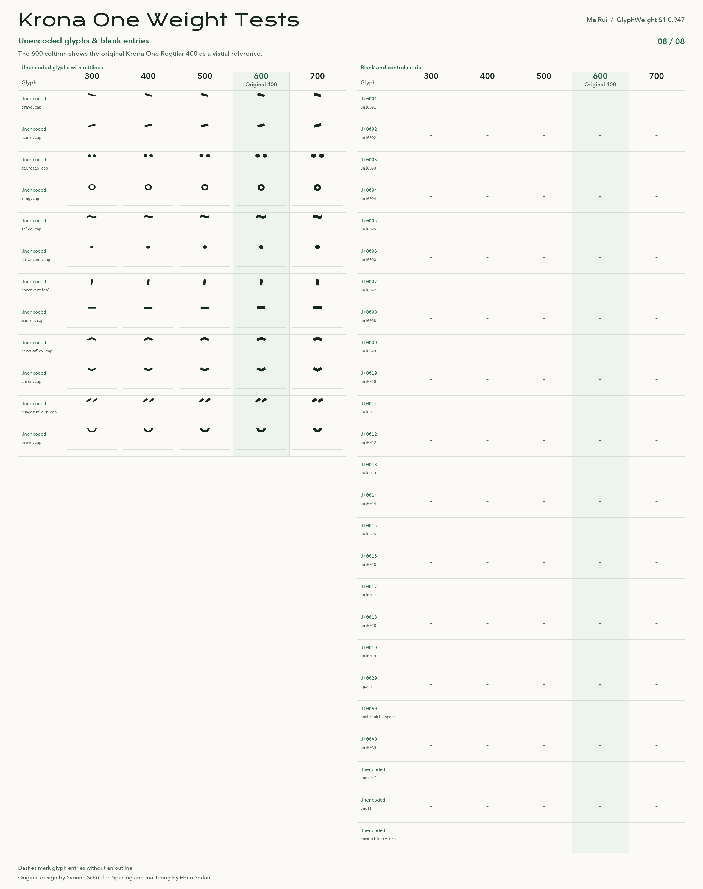

# 字符对照图 / Character sheets

每一行都是同一个字形，从左到右依次为 300、400、500、600 和 700。带底色的 600 一栏是原版 Krona One Regular。八张图共收录 411 个 Unicode 码位，另有 15 个未编码字形条目。点图可以放大查看。

Compare each glyph across five weights, from Light 300 on the left to Bold 700 on the right. The shaded 600 column shows the original Krona One Regular drawing. The eight sheets cover 411 Unicode code points and 15 unencoded glyph entries. Open any sheet for a closer look.

图上的 *GlyphWeight S1* 是做 v0.947 校样时的工作名称。正式发布的字体名为 **Kronb**。

The v0.947 proofs carry the project’s working name, *GlyphWeight S1*. The released family is **Kronb**.

[15 个代表字符 / 15 selected glyphs](selected-glyphs.png) · [返回宣传片与字体下载 / Back to the film and font files](../README.md#preview)

## 基础拉丁字符 / Basic Latin

## 扩展拉丁字符（1/4） / Extended Latin (1 of 4)

## 扩展拉丁字符（2/4） / Extended Latin (2 of 4)

## 扩展拉丁字符（3/4） / Extended Latin (3 of 4)

## 扩展拉丁字符（4/4） / Extended Latin (4 of 4)

## 数字与符号（1/2） / Numbers and symbols (1 of 2)

## 数字与符号（2/2） / Numbers and symbols (2 of 2)

## 未编码字形与空白条目 / Unencoded glyphs and blank entries

